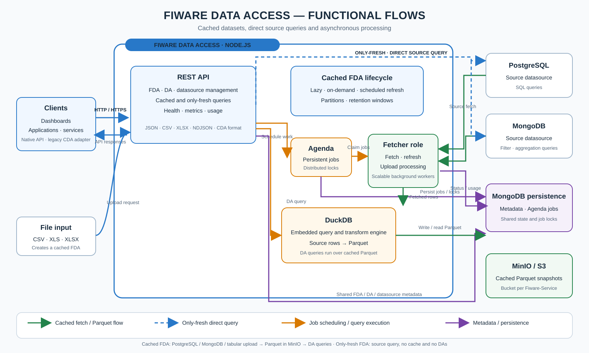
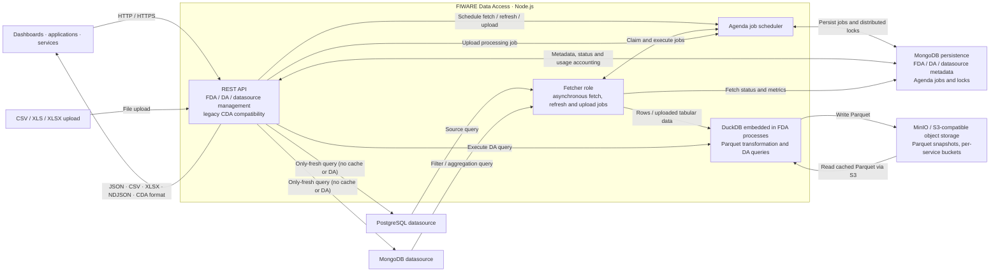

# Architecture

This document describes the system architecture of **FIWARE Data Access**, including main concepts and database model.

---

## Concepts

This section explains what an **FDA** and a **DA / CDA** are in the context of the FIWARE Data Access API.

### Datasource

A **Datasource** represents the connection definition FDA uses to access source systems.

In the current implementation:

-   Datasources are scoped by `Fiware-Service` and identified by `datasourceId`
-   FDAs store `datasourceId` and resolve credentials at execution time
-   Supported datasource types are `postgres` and `mongodb`
-   Tabular files can also be uploaded to create an FDA without a datasource

In simple terms:

> **A datasource is the reusable connection profile used by an FDA to fetch data from a source system.**

### FDA

An **FDA** represents a data resource in the system. A cached FDA:

-   Defines how data is extracted from a source database (PostgreSQL or MongoDB), or created from an uploaded tabular
    file
-   Stores the materialized result as **Parquet** in bucket-based object storage
-   Acts as the **base dataset** for one or more DAs
-   Supports optional `refreshPolicy` types `none`, `interval`, `window`, and `onDemand`; cached FDAs can also be lazy
-   Window-based FDAs can also schedule a periodic consistency refresh that triggers the manual rebuild flow and helps
    recover historical gaps.
-   Can use a generated `defaultDataAccess`; upload FDAs and source-backed FDAs can also have custom DAs

An only-fresh FDA instead queries its PostgreSQL or MongoDB source directly. It does not create a Parquet snapshot or
support DAs.

In simple terms:

> **A cached FDA is a reusable, materialized dataset. An only-fresh FDA queries its source without maintaining a
> snapshot.**

Key characteristics:

-   A cached FDA can be created from a PostgreSQL SQL query, a MongoDB filter/aggregation query, or an uploaded tabular
    file
-   Cached data is stored as Parquet inside a bucket named after the `Fiware-Service`
-   Associated with a `visibility` level (`public` or `private`) that controls access authorization
-   Can be regenerated (manually or configured) to refresh the data
-   Cached FDAs can be the parent resource of one or more DAs
-   Has status, progress, initFetch and lastFetch fields, and an optional refreshPolicy.

#### Example FDA

```http
POST /{visibility}/fdas
Fiware-Service: acme
Fiware-ServicePath: /servicePath
Content-Type: application/json
```

```json
{
    "id": "animals_fda",
    "description": "All animal activity records",
    "query": "SELECT * FROM animal_activity",
    "refreshPolicy": {
        "type": "interval",
        "params": { "refreshInterval": "1 hour" }
    }
}
```

---

### DA / CDA

A **DA (Data Access)**, also known as **CDA** in legacy Pentaho systems, is a **logical, parameterized query** executed
on top of an FDA.

It:

-   Does **not** store data
-   Defines how to query an existing FDA
-   Can be executed multiple times with different parameters
-   Returns results in JSON by default; CSV, XLSX and NDJSON are also supported
-   Does **not** include **FROM** clause. Access the FDA directly, you don't need to know the internal storage logic

In simple terms:

> **A DA (or CDA) is a saved analytical query over an FDA.**

Key characteristics:

-   Always associated with exactly one FDA
-   Contains a query definition
-   Supports URL parameters
-   Produces query results in the requested supported format
-   Used by dashboards, services, or external clients

#### Example DA

```http
POST /{visibility}/fdas/animals_fda/das
Fiware-Service: acme
Fiware-ServicePath: /servicePath
Content-Type: application/json
```

```json
{
    "id": "activity_by_species",
    "description": "Activity filtered by animal species",
    "query": "SELECT * WHERE animalspecies = ${species}"
}
```

---

## Architecture Overview

The functional overview below focuses on the current execution paths and main responsibilities.



The [original architecture diagram](images/FDA_diagram.png) is preserved as a historical reference. It provides a more
detailed view of the original components and numbered data flow, but does not reflect all current capabilities.

A corresponding Mermaid overview is included for easy editing:

<details>
<summary>Editable Mermaid source</summary>



</details>

The diagram distinguishes the two execution paths:

-   **Cached FDA:** the API schedules work through Agenda; a fetcher reads from PostgreSQL or MongoDB (or processes an
    uploaded CSV/XLSX file), DuckDB materializes Parquet in MinIO, and DA queries read that snapshot. Refreshes can be
    scheduled (`interval` or `window`), lazy, or triggered on demand. Partitioning and window retention are optional.
-   **Only-fresh FDA:** `GET /{visibility}/fdas/{fdaId}/data` executes directly against its PostgreSQL or MongoDB
    source. It has no Parquet snapshot and does not support DAs.
-   **Persistence and operations:** MongoDB stores FDA, DA and datasource metadata as well as Agenda jobs and locks. The
    API also exposes health, Prometheus/OpenMetrics and usage-accounting endpoints. FDA does not enforce storage quotas;
    MinIO bucket quotas are configured by operators.

DuckDB is an embedded library used by FDA processes, not a separately deployed query service. MinIO stores cached
Parquet objects; it is not the source database. Datasource credentials are resolved from MongoDB using
`service + datasourceId`.

---

## Database Model

`Fiware-Data-Access` uses MongoDB collections for FDA/DA metadata and datasource provisioning.

Usage accounting does not introduce a separate collection: its metadata is stored in the existing `fdas` documents.

### FDAs collection

Each document corresponds to one FDA:

-   **\_id**: MongoDB unique identifier
-   **fdaId**: FDA identifier
-   **createdAt**: timestamp of FDA creation (MongoDB Date)
-   **service**: FIWARE service (`fiware-service`) name
-   **servicePath**: FIWARE service path (`fiware-servicePath`) for access control
-   **visibility**: FDA access visibility level (`public` or `private`)
-   **description**: FDA description
-   **query**: SQL query used to generate the Parquet file
-   **das**: keymap of DAs associated with the FDA
-   **refreshPolicy**: object defining refresh behaviour (`none`, `interval`, `window`, or `onDemand`)
-   **status**: current execution status (`fetching`, `transforming`, `uploading`, `completed`, `failed`, `deleting`)
-   **progress**: execution progress percentage (0–100)
-   **initFetch**: timestamp of the current/last fetch start (ISO date)
-   **lastFetch**: timestamp of the last successful fetch completion (ISO date)
-   **access**: query counters (`count`, `sinceLastFetch`) and latest query timestamp (`lastAccessAt`)
-   **storage**: latest object-storage measurement (`bytes`, `objects`, `partitions`, `measuredAt`), when available
-   **lastRefresh**: metrics for the latest successful fetch or upload (`durationMs`, `bytesFetched`), when available
-   **\_accessFlushes**: internal map from tracker UUID to the last applied flush sequence, used to prevent duplicate
    counting when a batch is retried
-   **datasourceId**: datasource identifier used to resolve source credentials (default `default` when omitted)
-   **validationMode**: validation mode (`strict` or `unchecked`, default `strict`)
-   **schema**: array of column definitions (`name` and `type`) for the materialized Parquet (`strict` mode, cached FDAs
    only). `type` is a DuckDB type. For MongoDB FDAs, types are `null` until the first successful fetch, when the schema
    is derived from the materialized Parquet. See
    [Schema generation for schemaless datasources](#schema-generation-for-schemaless-datasources).

Each DA contains:

-   **description**: description of the DA
-   **query**: parameterized SQL query executed on the FDA
-   **params**: array of parameter definitions (optional)
-   **access**: the same counter structure as FDA-level `access`, restricted to queries of this DA

#### Usage accounting fields

FDA and DA `access` objects start with `count: 0`, `sinceLastFetch: 0`, and `lastAccessAt: null`. Accesses are buffered
in memory and periodically flushed to MongoDB, so persisted counters may lag behind recent queries. A successful fetch
or upload resets `sinceLastFetch` for the FDA and its DAs without resetting their lifetime `count`. A delayed batch from
an earlier fetch still updates `count`, but does not increment `sinceLastFetch` for the new dataset.

`storage` records the total size in bytes and number of objects belonging to the FDA, the number of partition folders,
and the measurement timestamp (`measuredAt`, a MongoDB Date). `lastRefresh.durationMs` records processing duration in
milliseconds, and `lastRefresh.bytesFetched` records the fetched or uploaded input size in bytes. These are latest
measurements, not cumulative totals.

Each tracker process generates a new UUID at startup. `_accessFlushes` retains one sequence per tracker that has flushed
accesses to the FDA; entries are currently not pruned. This map is internal deduplication metadata, not an access
history or a separate collection.

Older FDA documents may lack accounting fields until the corresponding operation populates them. Usage aggregation
treats missing numeric fields as zero.

#### Example MongoDB document

```json
{
    "_id": "695f9a3cc0d41d928f5e6a39",
    "fdaId": "fda1",
    "description": "Description for the first FDA",
    "query": "SELECT population, timeinstant, gender FROM exampleSchema.exampleTable",
    "servicePath": "/servicePath",
    "service": "fiwareService",
    "progress": 10,
    "initFetch": "2026-02-19T07:37:52.084Z",
    "lastFetch": null,
    "visibility": "public",
    "validationMode": "strict",
    "schema": [
        { "name": "population", "type": "INTEGER" },
        { "name": "timeinstant", "type": "TIMESTAMP" },
        { "name": "gender", "type": "Text" }
    ],
    "refreshPolicy": {
        "type": "interval",
        "params": { "refreshInterval": "1 hour" }
    },
    "das": {
        "da1": {
            "description": "First DA querying timeInstant and population.",
            "query": "SELECT * WHERE population = $population AND timeinstant = $timeinstant;",
            "params": [
                { "name": "population", "type": "Number" },
                { "name": "timeinstant", "type": "DateTime" }
            ]
        },
        "da2": {
            "description": "Second DA querying timeInstant and gender.",
            "query": "SELECT * WHERE gender = $gender AND timeinstant = $timeinstant;",
            "params": [
                { "name": "gender", "type": "Text" },
                { "name": "timeinstant", "type": "DateTime" }
            ]
        }
    }
}
```

#### Schema generation for schemaless datasources

Schemaless datasources such as MongoDB cannot provide a fixed schema at creation time. For cached FDAs in `strict` mode,
the schema is therefore generated in two steps:

1. **At creation time**, the column names come from the query: the `projection` for `filter` queries, or the final
   `$project`/`$group` stage for `aggregation` queries. Their types are stored as `null` because they are not known yet.
2. **After each successful fetch**, the schema is re-derived from the materialized Parquet using DuckDB. This updates
   both the column types and the column set when the source data changes.

As a consequence, the schema of a MongoDB FDA is not a stable field: it may change between refreshes if the documents in
the collection change their fields or value types.

For MongoDB:

-   Fields with different types across documents are materialized using the common type selected by DuckDB, typically
    `VARCHAR`.
-   Nested documents and arrays are materialized as `VARCHAR` JSON values.
-   Fields missing from some documents are materialized as `NULL`.
-   Hive partition columns are not included in the FDA schema.

In `unchecked` mode, columns are still inferred from the first document and the persisted schema is not created at FDA
creation time.

### Datasources collection

Each document corresponds to one datasource definition for one service:

-   **service**: FIWARE service (`fiware-service`) name
-   **datasourceId**: datasource identifier (unique within the service)
-   **type**: datasource type (`postgres` or `mongodb`)
-   **config**: connection settings (for postgres: `username`, `password`, `host`, `port`, `database`; for mongodb:
    `uri`, `database`)

#### Example MongoDB datasource document

```json
{
    "_id": "6960aa3cc0d41d928f5e6b99",
    "service": "fiwareService",
    "datasourceId": "default",
    "type": "postgres",
    "config": {
        "username": "postgres",
        "password": "postgres",
        "host": "localhost",
        "port": 5432,
        "database": "fiwareService"
    }
}
```

### Agenda Jobs Collection

When automatic refresh or manual regeneration is enabled, the system uses Agenda with MongoDB as a backend.

Agenda persists jobs in a separate MongoDB collection:

-   **Collection name**: `agendaJobs`
-   **Purpose**: Stores background jobs for FDA refresh and regeneration
-   **Managed by**: Agenda (not manually modified by application code)

Each document represents one scheduled or running job and includes:

-   Job metadata (`name`, `data`, `nextRunAt`)
-   Locking information (`lockedAt`, `lockLifetime`)
-   Retry tracking (`failCount`, `failReason`)
-   Execution timestamps (`lastRunAt`, `lastFinishedAt`)

> This collection is internal to Agenda and should not be modified directly.

> More details about asynchronous processing and job persistence can be found in
> [Advanced Topics – Async Processing and Jobs](/doc/AdvancedTopics/async_processing_and_jobs.md#6-job-persistence-in-mongodb).

---

## Key Points

-   The **bucket name** in MinIO must match the `fiware-service` of the FDA
-   FDA creation **does not create buckets automatically**; they must exist beforehand
-   DAs query the FDA Parquet files directly via DuckDB
-   Metadata in MongoDB ensures unique combination of `fdaId` and `service`
-   Datasources are managed per `Fiware-Service`; deleting a datasource referenced by at least one FDA is blocked with
    `DatasourceInUse`

---

## 🧭 Navigation

-   [⬅️ Previous: Installation](/doc/01_installation.md)
-   [🏠 Main index](../README.md#documentation)
-   [➡️ Next: API](/doc/03_api.md)
