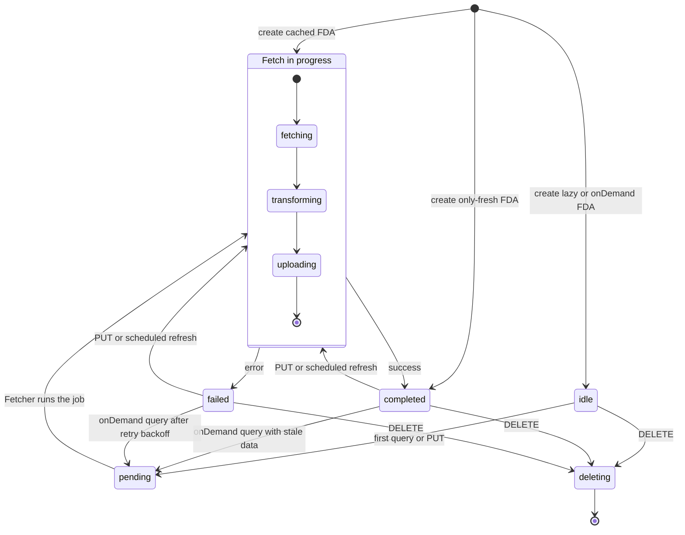
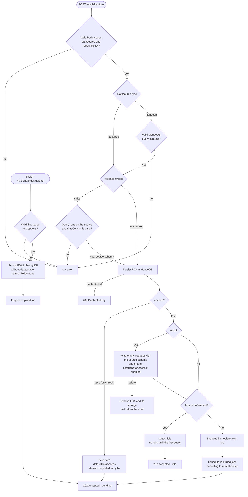
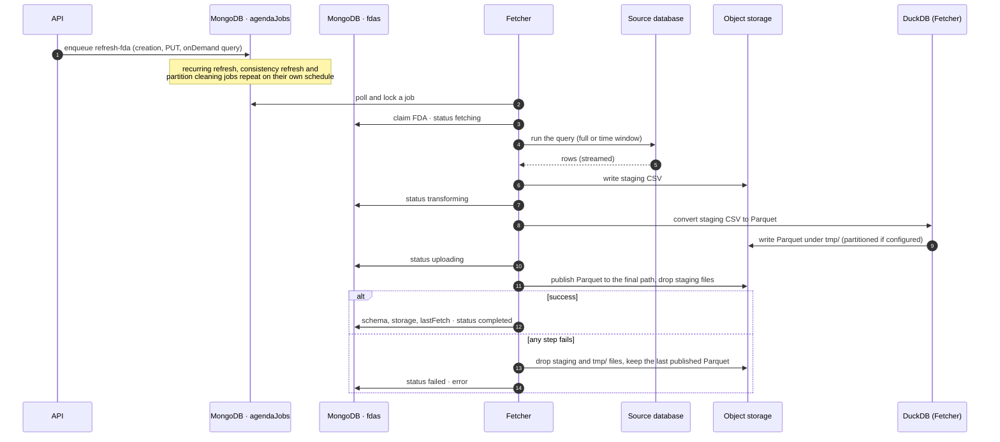
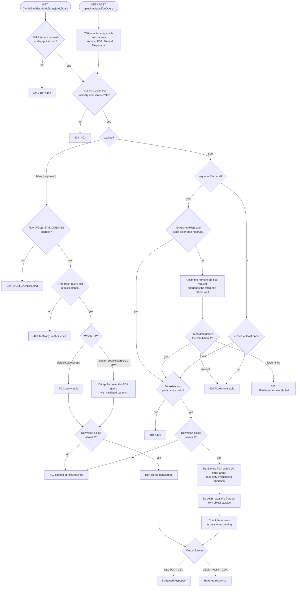

# Developers Guide

This document groups development-oriented guidance that is useful when working on the repository.

---

## Running in local development mode

For development purposes, it is often useful to run the FDA service locally while keeping dependencies running in
Docker.

### 1. Start infrastructure services

You can start only the required services using Docker:

-   PostgreSQL (PostGIS)
-   MongoDB
-   MinIO

For example, using Docker Compose:

```bash
docker compose -f docker/docker-compose.yml up minio mongo postgis
```

Ensure that:

-   PostgreSQL is reachable on port `5432`
-   MongoDB is reachable on port `27017`
-   MinIO is reachable on port `9000`

---

### 2. Use Node.js 24

FDA requires **Node.js 24**.

If you use `nvm`:

```bash
nvm use 24
```

Example output:

```text
Now using node v24.13.0 (npm v11.6.2)
```

---

### 3. Install dependencies

From the root of the repository:

```bash
npm install
```

---

### 4. Configure environment variables

Create a `.env` file (or export variables in your shell) with the required configuration.

At minimum, you will need:

```env
FDA_NODE_ENV=development
FDA_SERVER_PORT=8080

FDA_PG_POOL_MAX=10
FDA_PG_POOL_IDLE_TIMEOUT_MS=10000
FDA_PG_POOL_CONN_TIMEOUT_MS=5000
FDA_PG_POOL_DB_IDLE_TIMEOUT_MS=300000

FDA_OBJSTG_PROTOCOL=http
FDA_OBJSTG_ENDPOINT=localhost:9000
FDA_OBJSTG_USER=admin
FDA_OBJSTG_PASSWORD=admin123

FDA_MONGO_URI=mongodb://localhost:27017
```

Refer to [`04_config_operational_guide.md`](./04_config_operational_guide.md) for the full list of configuration
options.

---

### 5. Start the FDA service

Run:

```bash
npm start
```

You should see the FDA service starting and listening on port `8080`.

---

### 6. Provision datasource(s)

FDA resolves PostgreSQL connection credentials from datasource resources (no global PostgreSQL user fallback).

Create at least one datasource for your `Fiware-Service` before creating FDAs:

```bash
curl -i -X POST http://localhost:8080/datasources \
  -H "Content-Type: application/json" \
  -H "Fiware-Service: trantor" \
  -d '{
    "type": "postgres",
    "config": {
      "username": "postgres",
      "password": "postgres",
      "host": "localhost",
      "port": 5432,
      "database": "trantor"
    }
  }'
```

---

## Available npm Scripts

The following scripts are defined in `package.json` and can be executed with `npm run <script>` (`npm start` and
`npm test` can be used without `run`). Extra arguments can be forwarded to the underlying tool after `--`, for example
`npm test -- test/unit`.

### Development

| Script  | Description                                                                                                                                                                                                |
| ------- | ---------------------------------------------------------------------------------------------------------------------------------------------------------------------------------------------------------- |
| `start` | Starts the FDA service (`node src/index.js`). Used by the Docker image. Requires the configuration described in [`04_config_operational_guide.md`](./04_config_operational_guide.md) (e.g. a `.env` file). |
| `dev`   | Starts the FDA service with `nodemon`, restarting it automatically when source files change. Intended for local development only. Same configuration requirements as `start`.                              |
| `clean` | Removes `node_modules` and `package-lock.json`. Useful to force a clean reinstall of dependencies; run `npm install` afterwards.                                                                           |

### Linting and Formatting

| Script      | Description                                                                                                                                   |
| ----------- | --------------------------------------------------------------------------------------------------------------------------------------------- |
| `lint`      | Runs `lint:api` and `lint:test`. This is the check executed in CI, so run it before opening a pull request.                                   |
| `lint:api`  | Runs ESLint over the application sources (`src/lib/` and `src/routes/`).                                                                      |
| `lint:test` | Runs ESLint over the integration tests (`test/integration/`).                                                                                 |
| `lint:fix`  | Runs ESLint over `src/lib/` and `src/routes/` applying automatic fixes. Test files are not fixed by this script.                              |
| `prettier`  | Formats all JavaScript files of the repository with Prettier using `.prettierrc.json`. Modifies files in place, so review the resulting diff. |

ESLint scripts use `--cache`, storing results in `.eslintcache` (ignored by git). Additionally, a `husky` pre-commit
hook runs `lint-staged`, which formats staged `*.js` and `*.md` files with Prettier automatically.

### Tests

All test scripts run Jest in band (`--runInBand`) with `NODE_ENV=test` and `--experimental-vm-modules` (required for ES
modules). Integration and performance tests require Docker to be running, since dependencies are started with
Testcontainers.

| Script                    | Description                                                                                                                                                                                                                                                                        |
| ------------------------- | ---------------------------------------------------------------------------------------------------------------------------------------------------------------------------------------------------------------------------------------------------------------------------------- |
| `test`                    | Runs every `*.test.js` file of the repository (unit, integration and performance suites). Because the performance suite is included, a full run can take a long time; pass a path or a name filter to narrow it down (e.g. `npm test -- test/unit` or `npm test -- -t "pattern"`). |
| `test:performance`        | Runs only the performance suite (`test/performance`). See [Performance](./07_performance.md) for available parameters.                                                                                                                                                             |
| `test:performance:memory` | Runs the DuckDB window memory scenarios of the performance suite (`FDA_MEMORY_MATRIX=true`) with a 3,000,000-row source table. Demanding in time and memory. See [DuckDB memory management](./AdvancedTopics/duckdb_memory_management.md).                                         |

### Coverage

Coverage is collected with `c8` over `src/**/*.js` and written in `lcov` and text-summary formats. See
[Testing: Coverage Considerations](./06_testing.md#coverage-considerations) for details on how reports are merged.

| Script                      | Description                                                                                                                                    |
| --------------------------- | ---------------------------------------------------------------------------------------------------------------------------------------------- |
| `test:coverage`             | Runs all test suites (same scope as `test`) collecting coverage into `coverage/`.                                                              |
| `test:coverage:unit`        | Runs only the unit tests (`test/unit`) collecting coverage into `coverage/unit/`. Does not require Docker. Executed in CI.                     |
| `test:coverage:integration` | Runs only the integration tests (`test/integration`) collecting coverage into `coverage/integration/`. Requires Docker. Executed in CI.        |
| `test:coverage:merge`       | Merges `coverage/*/lcov.info` into `coverage/lcov.info` using `lcov-result-merger` (downloaded through `npx`, network access may be required). |
| `test:coverage:ci`          | Runs `test:coverage:unit`, `test:coverage:integration` and `test:coverage:merge` in sequence, reproducing locally the report published by CI.  |

### OpenAPI

| Script             | Description                                                                                                                                                                                                               |
| ------------------ | ------------------------------------------------------------------------------------------------------------------------------------------------------------------------------------------------------------------------- |
| `openapi:generate` | Generates `openapi.generated.json` (ignored by git) from the `@swagger` JSDoc annotations in `src/routes/*.js` and `src/lib/openapiComponents.js`.                                                                        |
| `openapi:validate` | Runs `openapi:generate` and lints the generated spec with `@redocly/cli` (downloaded through `npx`, network access may be required). Executed in CI; run it after changing API routes or their documentation annotations. |

---

## Internal flows

This section describes how the main operations flow through the API and Fetcher roles introduced in the
[Architecture Overview](/doc/02_architecture.md#architecture-overview). The diagrams show the decisions that shape each
flow; the full list of validations and error responses of every endpoint is in the [API reference](/doc/03_api.md).

### FDA lifecycle

The `status` field of an FDA moves through these states:



DAs of a cached FDA can be queried as soon as its first fetch has completed (`lastFetch` is set). From then on, a
running refresh or a failed one does not block queries: they keep reading the last published snapshot.

### FDA creation

FDAs are created from a datasource query (`POST /{visibility}/fdas`) or from an uploaded file
(`POST /{visibility}/fdas/upload`). The API does all the synchronous work and returns `202 Accepted`; data is always
fetched later by a Fetcher.



The jobs scheduled for a cached FDA depend on its `refreshPolicy`:

| `refreshPolicy` | First fetch                                               | Recurring jobs                                                                                                                                    |
| --------------- | --------------------------------------------------------- | ------------------------------------------------------------------------------------------------------------------------------------------------- |
| `none`          | Full query, at creation                                   | None                                                                                                                                              |
| `interval`      | Full query, at creation                                   | Full refresh every `refreshInterval`; partition cleaning when `windowSize` is set                                                                 |
| `window`        | Last `windowSize` (or full query), at creation            | Incremental refresh of the last `fetchSize` every `refreshInterval`; optional full rebuild every `consistencyRefreshInterval`; partition cleaning |
| `onDemand`      | On the first query, and again when a query finds it stale | None: each stale query triggers a refresh, incremental from the last fetched partition when partitioned                                           |

A lazy `interval` or `window` FDA schedules its recurring jobs when its first query triggers the first fetch. See
[Lazy FDAs](/doc/AdvancedTopics/lazy_fdas.md) and
[Sliding windows and partitioning](/doc/AdvancedTopics/sliding_windows_and_partitioning.md) for details.

### Fetch and refresh jobs

The API and the Fetcher only communicate through MongoDB: the API (or Agenda, for recurring jobs) leaves a job in the
`agendaJobs` collection, and any Fetcher instance locks and runs it.



The upload job follows the same pattern, but reads the uploaded file from the upload temporary directory instead of
querying a source. Partition cleaning jobs only delete the partitions older than `windowSize`. See
[Async Processing & Jobs](/doc/AdvancedTopics/async_processing_and_jobs.md) for job persistence, locking and
concurrency.

### Data queries

Data is always read through a DA. The legacy CDA endpoint is an adapter that maps its parameters onto the same flow.



A lazy or onDemand query never triggers more than one fetch: concurrent queries share it and poll the FDA status until
the data is available. The fresh-query slots and the access counters are kept per API instance. See
[CDA legacy compatibility](/doc/AdvancedTopics/cda_legacy_compatibility.md) for the CDA mapping and
[Default Data Access](/doc/AdvancedTopics/default_data_access.md) for the generated DA and its `timeRange`.

---

## Documentation conventions

-   Every new or changed environment variable must be documented in
    [`04_config_operational_guide.md`](./04_config_operational_guide.md).
-   Every API change must be reflected in [`03_api.md`](./03_api.md).
-   Diagrams are written in Mermaid inside the Markdown files, not as images. Update them only when a change adds,
    removes or reorders a branch of a flow, not for changes in validations, defaults or error details.
-   OpenAPI/Swagger annotations must be kept in sync with API changes and validated with:
    -   `npm run openapi:generate`
    -   `npm run openapi:validate`

---

## 🧭 Navigation

-   [⬅️ Previous: Performance](/doc/07_performance.md)
-   [🏠 Main index](../README.md#documentation)
